# The Ford-Johnson-Algorithm (aka merge insertion)

The Ford-Johnson algorithm, aka merge insertion sort, is a sorting algorithm described by Donald Knuth in Volume 3 of [The Art of Computer Programming](https://en.wikipedia.org/wiki/The_Art_of_Computer_Programming).

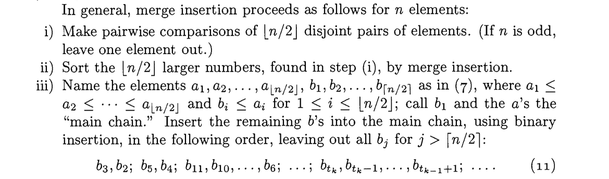

The algorithm is designed to minimize the number of *comparisons* required to sort a given group of elements, in the worst case. Among students in the C/C++ curriculum at 42, the Ford-Johnson / merge-insertion algorithm is infamous, as the subject of our final and most complex C++ exercise module.

# The Steps of Merge Insertion for $n$ Elements

## Step 1 (merge)

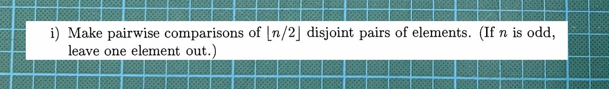

*"i) Make pairwise comparisons of $`{\lfloor n/2 \rfloor}`$ disjoint pairs of elements. (If $`n`$ is odd, leave one element out.)"*

This step is easy. First, out of $n$ elements, we create *$`{\lfloor n/2 \rfloor}`$ disjoint pairs*. If one element is leftover, we save it to the side.

> FYI: You might notice that $`{\lfloor this \rfloor}`$ is not a normal [ ] bracket
>
> ⌊n/2⌋ means floor, aka "n/2 rounded down." ⌈n/2⌉ means ceiling, aka "n/2" rounded up."
> You may have to squint to see the difference in these characters as they're rendered here. The same symbols are a bit better pronounced in the clip of Knuth's text.
 

*"Make pairwise comparisons of $`{\lfloor n/2 \rfloor}`$ disjoint pairs"*... In other words, sort each pair internally. This will require 1 comparison per pair. *Is pair[0] > pair[1]?* Keep track of the total number of comparisons you perform, from beginning to end of the algorithm.

// TODO talk about how Step 1 resembles regular merge sort.

## Step 2 (recurse)

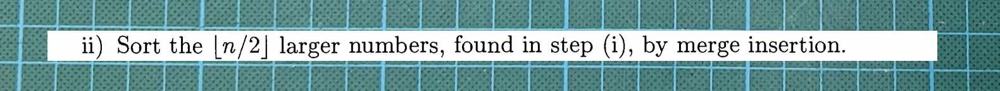

> ii) Sort the $\lfloor n/2 \rfloor$ larger numbers, found in step (i), by merge insertion.

Step 2 of merge insertion is... merge insertion. Perform the same algorithm in its entirety (Steps 1-3) on the larger elements found in Step 1.

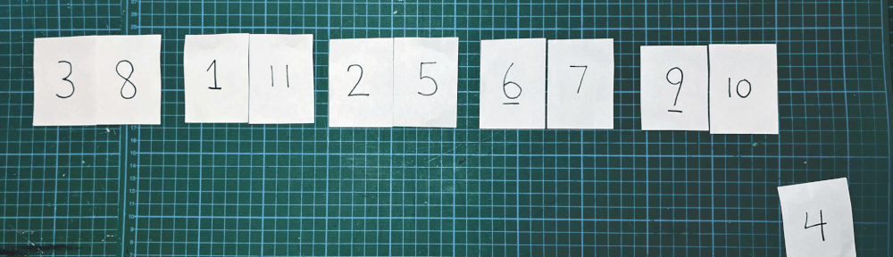

The program will "wind up" by cycling through Steps 1-2 repeatedly (as seen in the animation above), and when the base case is reached (nothing is left to pair-and-order), it will "unwind" back through as many rounds of Step 3.

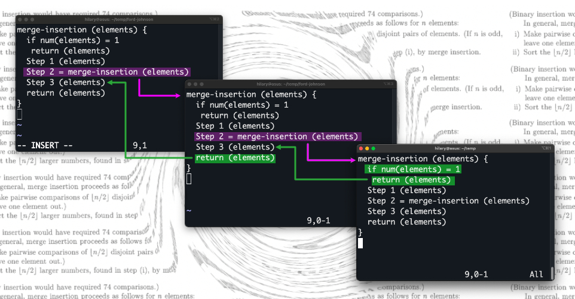

When the recursion eventually unwinds, the pairs that we've been creating and sorting will still be associated. For this reason, it's essential to keep track of each element's pair. In my illustration, I'm using paperclips to keep track of pairs. In my code, I'm using pointers.

## Step 3 (Jacobsthal insertion)

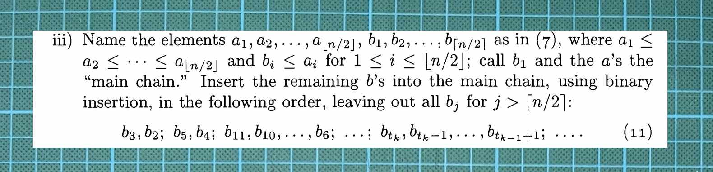

The description of Step 3 is quite dense, so let's break it into smaller pieces.

### Step 3.1 (Creating the "main chain")

Reminder: the first time we enter Step 3, we will have just hit our base case, in which there's nothing left to sort by pairing-and-ordering. When we first unwind, we'll only be dealing with a single pair.

However, it will be much easier to see what's going on in Step 3 with a larger group of elements in front of us. In the illustration below, I'll allow the algorithm to unwind twice through Step 3, before we stop to examine what Step 3 is doing, in its third and final round.

Illustration here

> iii) Name the elements $a_1, a_2, \ldots, a_{\lfloor n/2 \rfloor}, b_1, b_2, \ldots, b_{\lceil n/2 \rceil}$ as in (7), where $a_1 \le a_2 \le \cdots \le a_{\lfloor n/2 \rfloor}$ and $b_i \le a_i$ for $1 \le i \le \lfloor n/2 \rfloor$;

The diagram (7) is on page 184:

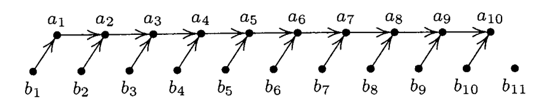

Given $n$ elements, up to ${n/2}$ of them are the ${ a }$'s, and these ${a}$'s are already ordered.

Conveniently, this is exactly what the previous steps (including two rounds through Step 3) have given us. Of 11 total elements, here we have 5 pairs, plus one leftover. The larger element of each pair is placed on top, and these elements are already in ascending order. These elements are the ${a}$'s.

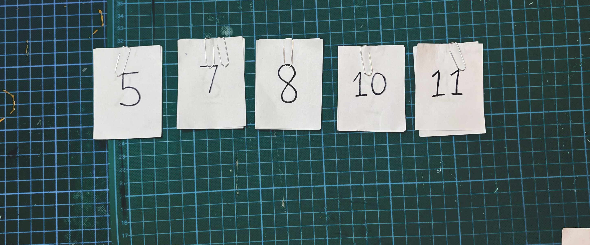

The remaining elements (the other half of each pair, plus a possible leftover) are the $b$'s. These elements aren't ordered among themselves, but we do know that each ${b}$ is smaller than its corresponding ${a}$.

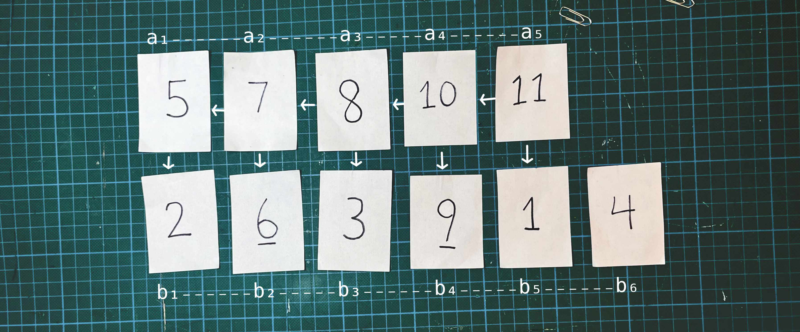

At this stage, the already-known relationships between elements will start saving us comparisons. Next:

>call $b_1$ and the $a$'s the "main chain."

Given that: the ${a}$'s are sorted, ${a_1}$ is the smallest ${a}$, and ${b_1 < a_1}$, we can go ahead and place ${b_1}$ before ${a_1}$. This is an action that requires no comparisons.

So, remove the first element of ${b}$ and add it as the new first element of ${a}$. This group ( $b_1$ and all the $a$`s) will from now on be referred to as the "main chain."

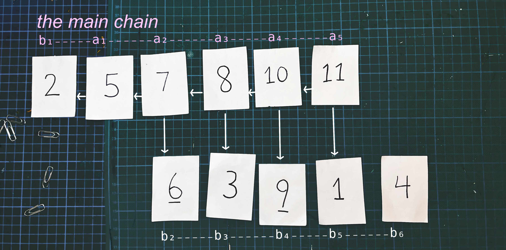

### Step 3.2 (Generating the Insertion Sequence)

>Insert the remaining $b$'s into the main chain, using binary insertion, in the following order, leaving out all $b_j$ for $j > \lceil n/2 \rceil$:
> $$b_3, b_2; \ b_5, b_4; \ b_{11}, b_{10}, \ldots, b_6; \ \ldots; \ b_{t_k}, b_{t_k-1}, \ldots, b_{t_{k-1}+1}; \ \ldots$$

We will now insert the rest of the $b$'s into $a$. Since our goal is to minimize the number of comparisons in the worst case, and top array is sorted, [binary insertion](https://en.wikipedia.org/wiki/Binary_search) is the natural choice. However, the order in which we insert the $b$'s won't simply be from left to right, or from beginning to end of the $b$ array.

The order that Knuth is describing can't be read in a first glance. What is this new subscript variable $t$... and sub-subscript variable $k$? Actually, we've given more context on the same page:

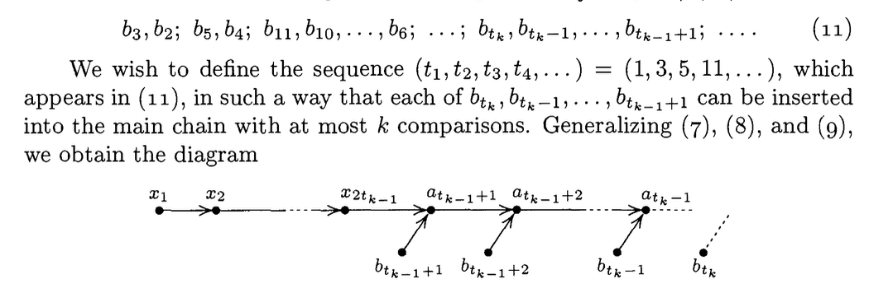

$t$ is described as the sequence $(1, 3, 4, 11...)$, which as everyone knows (joke), is the [Jacobsthal Sequence](https://en.wikipedia.org/wiki/Jacobsthal_number). 

The Jacobsthal sequence begins with 0 and 1. Each following number in the sequence is equal to... the previous number + two times the number before the previous number.

> 0, 1, 2, 3, 5, 11, 21, 43, 85, 171, ...

Do yourself a favor and write a function that generates this Jacobsthal sequence ($t$), up to a given max value. Call the index of this sequence $k$. Accept that in this kooky math world, the first index is 1 instead of 0. 

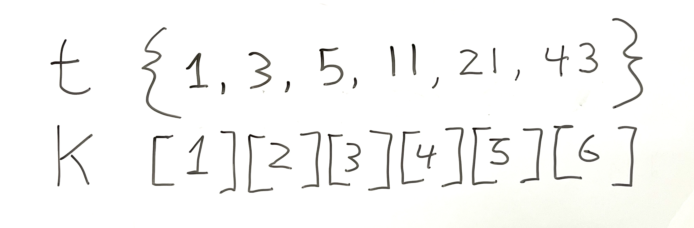

From here, the instructions for insertion order become a bit easier to read. The best way to follow is work out for yourself what is $t_k, t_k - 1, ..., t_{k-1} + 1$, like I've done for myself here:

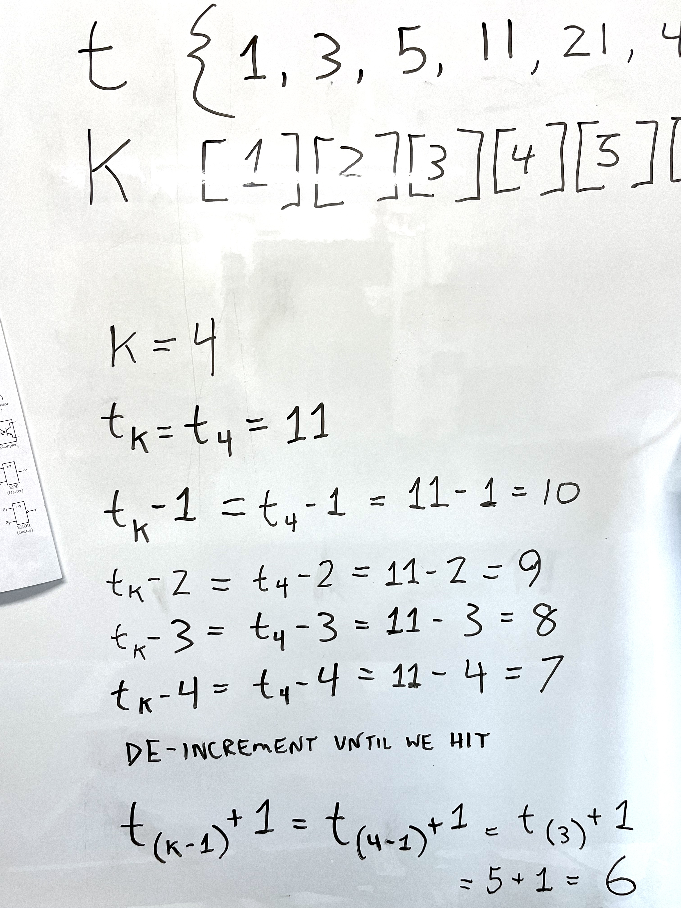

### Step 3.3 (Insert)

The sequence that we've generated is: 1; 3, 2; 5, 4; 11, 10, 9, 8, 7, 6; 21, 20... 

We will now insert the $b's$ into the main chain based on this sequence. The magic of this order is that it limits the number of comparisons required to no more than $k$, which is the index (starting at 1) of the Jacobsthal number used.

In the example above, our next step is to insert $b_3$. Since we already know that $b_3$ is smaller than $a_3$, we can begin our binary search at the center of the main chain up until this point. We can see that we'll need a maximum of 2 comparisons to place $b_3$. Depending where $b_3$ ends up, the search area for inserting $b_2$ might or might not increase by one, but the search area divded by two, which equals maximum comparisons, remains the same. Had we inserted $b_2$ before $b_3$, the maximum comparisons needed to place $b_3$ would have automatically increased.