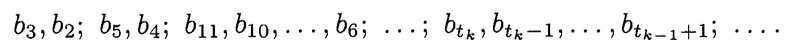

# The Ford-Johnson-Algorithm

The Ford-Johnson algorithm, aka merge insertion sort, is a sorting algorithm described by Donald Knuth in Volume 3 of [The Art of Computer Programming](https://en.wikipedia.org/wiki/The_Art_of_Computer_Programming).

The algorithm is designed to minimize the number of *comparisons* required to sort a given group of elements, in the worst case. Among students in the C/C++ curriculum at 42, the Ford-Johnson / merge-insertion algorithm is infamous, as the subject of our final and most complex C++ exercise module.

[Here an illustration?]

# The steps of *merge insertion* for $n$$ elements

## 1) Create pairs & sort each pair.
> i) Make pairwise comparisons of $\lfloor n/2 \rfloor$ disjoint pairs of elements. (If $n$ is odd, leave one element out.)

This is the step that resembles merge sort.
- Create n/2 pairs
- Fill each pair with 2 elements
- If n % 2 != 0, do not include the leftover element in the pairs. Save it aside.
- Sort each pair internally.

## 2) Perform *merge insertion* on the larger element of each pair
> ii) Sort the $\lfloor n/2 \rfloor$ larger numbers, found in step (i), by merge insertion.

Step 2 of merge insertion is... merge insertion! This means we go back to the top and perform the same algorithm in its entirety (Steps 1-3) on the larger elements of each set.

Many summaries of merge-insertion tend to skip or gloss over this recursion. Many students misread this step as requiring regular merge sort, and/or may misunderstand the recursion as calling only step 2 or steps 1-2 repeatedly. I made these mistakes too, at first.

When the recursion unwinds, in Step 3, the pairs that you've been creating and sorting will be unwrapped again. For this reason, it's essential to keep track of each element's pair throughout all steps. Students have devised various ways of tracking the pairs, and for me, using pointers made the most sense.

## 3) Split elements into 2 chains. Perform insertion according to sequence formula.

> iii) Name the elements $a_1, a_2, \ldots, a_{\lfloor n/2 \rfloor}, b_1, b_2, \ldots, b_{\lceil n/2 \rceil}$ as in (7), where $a_1 \le a_2 \le \cdots \le a_{\lfloor n/2 \rfloor}$ and $b_i \le a_i$ for $1 \le i \le \lfloor n/2 \rfloor$; call $b_1$ and the $a$'s the "main chain." Insert the remaining $b$'s into the main chain, using binary insertion, in the following order, leaving out all $b_j$ for $j > \lceil n/2 \rceil$:
>
>$`\quad b_3, b_2;\; b_5, b_4;\; b_{11}, b_{10}, \ldots, b_6;\; \ldots;\; b_{t_k}, b_{t_k - 1}, \ldots, b_{t_{k-1}+1};\; \ldots \qquad`$

This step is very dense, so let's comb through it line by line.

My explanations will draw from additional text on the same page, as well as the diagram on page 184.

 

> Name the elements $a_1, a_2, \ldots, a_{\lfloor n/2 \rfloor}, b_1, b_2, \ldots, b_{\lceil n/2 \rceil}$ as in (7), where $a_1 \le a_2 \le \cdots \le a_{\lfloor n/2 \rfloor}$ and $b_i \le a_i$ for $1 \le i \le \lfloor n/2 \rfloor$;

- Break the elements into 2 groups, keeping them in order.
- Group "a" ($a_1, a_2$, ...), includes up to n/2 elements. (If n is odd, round down)
- Group "b" ($b_1, b_2$, ...) includes up to n/2 elements. (If n is odd, round up)

	This lower bracket notation ... ${\lfloor n/2 \rfloor}$ ... means floor, aka "n/2 rounded down."
	
	This upper bracket notation ... ${\lceil n/2 \rceil}$ ... means ceiling, aka "n/2" rounded up."

- As the elements were already ordered, the first element of "b" should be less than the first element of "a."

 

> Call $b_1$ and the $a$'s the "main chain." 

- Remove the first element of "b" and add it as the new first element of "a." This group ( $b_1$ and all the $a$`s) will from now on be referred to as the "main chain."

> Insert the remaining $b$'s into the main chain, using binary insertion, in the following order, leaving out all $b_j$ for $j > \lceil n/2 \rceil$:
>
>$`\quad b_3, b_2;\; b_5, b_4;\; b_{11}, b_{10}, \ldots, b_6;\; \ldots;\; b_{t_k}, b_{t_k - 1}, \ldots, b_{t_{k-1}+1};\; \ldots \qquad`$

- Now we will insert $b$'s into the main chain according to a particular formula that uses a special sequence of numbers. The these tiny subscripted values are getting hard to read... and there's further explanation about them in the text, so let's zoom out here.

## What's Involved in Merge-Insertion (a preview)

From the name alone, you might imagine a simple combo of merge-sort and insertion-sort. Merge- and insertion-sort are indeed both involved, but the algorithm also requires pairing elements, as well as inserting elements into a chain in a particular order. The insertion is done based on a formula that uses a sequence of numbers, called the Jacobsthal sequence. More on this later.

The trickiest part is... that all steps of the alogrithm are part of a single recursion. Many summaries of merge-insertion tend to skip or gloss over this recursion, and many students make the mistake of believing that only part of the alogrithm is recursive. I made this mistake too, at first.

To test whether you've implemented the right algorithm, you should count the number of comparisons that your program performs to sort *n* numbers. If done correctly, this number will match the table of maximum comparisons shown on page 186 of *The Art of Computer Programming, Vol. 3*.

## Brushing up on Merge Sort & Insertion Sort

Before digging into the Ford-Johnson, it's nice to brush up on merge sort and insertion sort. For one thing, you'll you have to implement  both as part of FJ. For another thing, it's going to be super helpful for your understanding of FJ to remember the particular advantages of merge sort vs. insertion sort, and in what cases each of the two is efficient.

- Merge Sort // TODO link to merge sort summary
- Insertion Sort // TODO link to insertion sort summary

## Jacobsthal Numbers

There's also one more thing you might like to know about before reading the Knuth text, and that's the Jacobsthal Numbers. The Jacobsthal numbers are an sequence of integers related to Fibonacci numbers, which will be used in our formula for insertion.

The sequence begins with 0 and 1. Each following number in the sequence is equal to... the previous number + two times the number before the previous number.

> 0, 1, 2, 3, 5, 11, 21, 43, 85, 171, ...

The definition of the sequence may sound convoluted, but you'll find that you can write a function to generate these numbers very easily.

You might find it helpful to do this right now, because in the text, Knuth is going to make reference to the Jabobsthal Numbers out of nowhere (without naming them, just describing how they're generated), and as soon as they've been introduced, you're going to have to create an additional sequence with them. Better to have some familiarity first.

As for why these numbers are relevant to the algorithm... By the time you're finished, this will hopefully make a lot more sense, but will likely still remain a least somewhat magical. For now, you may just enjoy noticing that each number in the sequence is about double the previous number, give or take 1.

# Reading Knuth

> In general, merge insertion proceeds as follows for $n$ elements:
>
> i) Make pairwise comparisons of $\lfloor n/2 \rfloor$ disjoint pairs of elements. (If $n$ is odd, leave one element out.)
>
> ii) Sort the $\lfloor n/2 \rfloor$ larger numbers, found in step (i), by merge insertion.
>
> iii) Name the elements $a_1, a_2, \ldots, a_{\lfloor n/2 \rfloor}, b_1, b_2, \ldots, b_{\lceil n/2 \rceil}$ as in (7), where $a_1 \le a_2 \le \cdots \le a_{\lfloor n/2 \rfloor}$ and $b_i \le a_i$ for $1 \le i \le \lfloor n/2 \rfloor$; call $b_1$ and the $a$'s the "main chain." Insert the remaining $b$'s into the main chain, using binary insertion, in the following order, leaving out all $b_j$ for $j > \lceil n/2 \rceil$:
>
>$$b_3, b_2;\; b_5, b_4;\; b_{11}, b_{10}, \ldots, b_6;\; \ldots;\; b_{t_k}, b_{t_k - 1}, \ldots, b_{t_{k-1}+1};\; \ldots \qquad